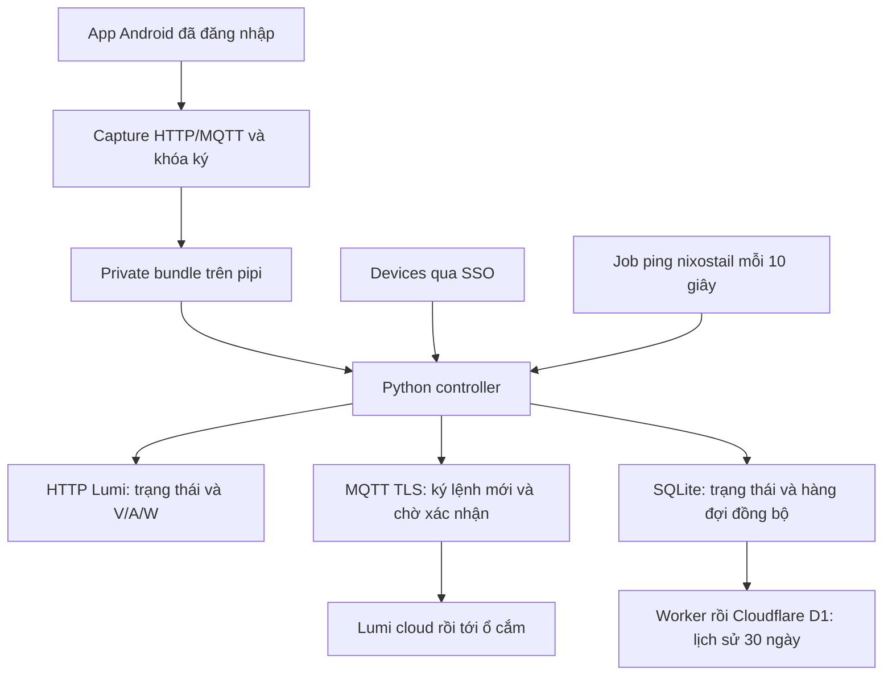

# Lumi IoT API

Controller Python cho ổ cắm Lumi IoT của chủ tài khoản: đọc trạng thái và V/A/W,
gửi lệnh MQTT có chữ ký, dashboard và công cụ khôi phục phiên Android.

## Bắt đầu

- [Khôi phục credentials và dựng lại Android](app/RECOVERY.md).
- [Cấu hình Android/APK/Frida đã kiểm chứng](app/tools/android-build.json).
- Code đang được duy trì trong `app/`; Python 3.12+, OpenSSL và Node.js cho test biểu đồ.

```bash
cd app
rtk proxy python3 test_recovery.py
rtk proxy python3 test_local.py
rtk proxy python3 test_host_status.py
rtk proxy python3 test_d1_sync.py
rtk proxy node test_chart.js
```

Các test chạy offline, không bật/tắt thiết bị và không cần credentials thật.
Recovery đã được thử với capture cũ; chưa diễn tập lại đăng nhập từ AVD trắng.

## Cách kết nối Lumi



**Vẫn cần đăng nhập Lumi:** controller tái sử dụng credentials của phiên app.
Chưa có tự đăng nhập hoặc gia hạn HTTP/MQTT credentials. Khóa ký tạo JWT mới
không gia hạn phiên. Mất mạng không tự làm mất khóa.

Controller gửi mỗi lệnh một lần, chờ phản hồi đúng request/device/trạng thái,
không tự retry lệnh khi timeout. Ping mất kết nối không chứng minh máy đã
shutdown an toàn. Link Power mở giao diện để người dùng tự shutdown; không tự cắt điện.

## Source và triển khai

Bản app này tách từ `infra-selfhost` commit `6b7b544`, giữ nguyên logic runtime.
Repo này là nguồn code/recovery độc lập; tạo repo hoặc push không tự deploy pipi.
Bản triển khai hiện dùng bản sao `apps/lumi-iot` trong infra-selfhost; khi cập nhật
runtime cần đồng bộ có kiểm tra và deploy riêng.

- [Docker/Glance/Devices](https://github.com/nguyenhuy158/infra-selfhost/tree/main/dockge/stacks/glance-pipi).
- [Worker D1 và SSO](https://github.com/nguyenhuy158/infra-vm-setup/tree/main/gate).
- [Jobs pipi](https://github.com/nguyenhuy158/infra-vm-setup/blob/main/setup.d/85-jobs.sh).
- [Skill dựng lại và vận hành](https://github.com/nguyenhuy158/skills/tree/main/plugins/workflow/skills/lumi-iot).

Container dùng `app/Dockerfile`, port 8765; production chỉ publish qua loopback
và SSO. Server không tự cung cấp đăng nhập, không expose port trực tiếp ra Internet.
`LUMI_SECRETS` mặc định `/run/lumi`, `LUMI_DB` mặc định `/data/history.sqlite3`,
`LUMI_ORIGIN` phải khớp dashboard. D1 config ở `/run/lumi/d1.json`.
Không chạy controller cùng app Android dùng chung MQTT client ID.

## Những gì chỉ giữ local

Clone GitHub chỉ lấy code, test, hướng dẫn và checksum. Không có APK, credentials,
private key, capture, SQLite, binary Frida hay lịch sử Git từ các repo cũ.

Trên Mac hiện tại, gốc lưu trữ là `~/Documents/personal-projects/lumi-iot-api/`:

| Đường dẫn | Nội dung |
|---|---|
| `private/apk/Lumi-IoT-2.1.0/` | APK gốc và split APK |
| `state/vm-export/` | Bộ credentials đã export; có thể đã hết hạn |
| `state/`, `evidence/` | Khóa, capture, log và bằng chứng riêng |
| `tools/`, `.venv/` | Binary Frida/Flutter và môi trường local cũ |
| `private/archives/` | Capture và bằng chứng được chuyển từ `/tmp` |
| `private/worktrees/` | Hai checkout hạ tầng được chuyển bằng Git worktree |
| `private/legacy-local/README.md` | Hướng dẫn prototype cũ |

Các file prototype cũ ở root được giữ nguyên để không phá đường dẫn local;
không được track. Chạy code mới từ `app/`. Credentials live vẫn ở
`pipi:/opt/config/lumi/`, không bị thay đổi bởi việc gom repo.

`.gitignore` chỉ cho phép danh sách source cụ thể. File public mới phải được
thêm vào allowlist sau khi kiểm tra. Không force-add dữ liệu riêng. Công cụ
capture/export cố ý từ chối ghi output trong Git: tạo ở thư mục private ngoài
Git theo runbook, sau đó chuyển vào `private/` nếu cần lưu cùng dự án.
